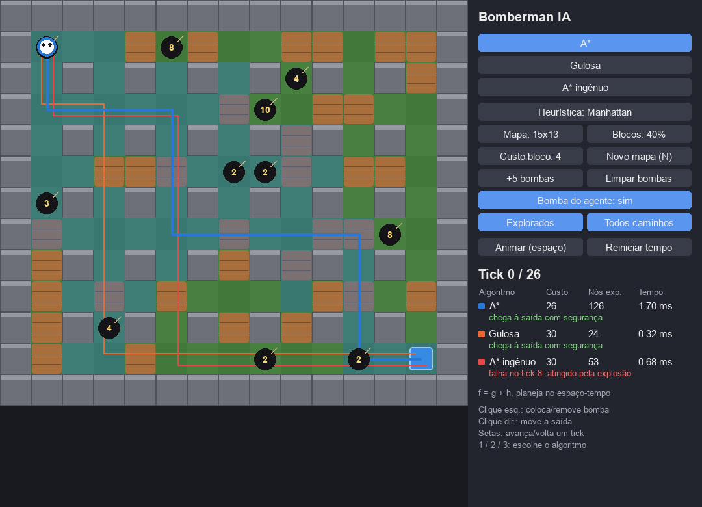

# Bomberman IA — A* x Busca Gulosa

Um agente de Bomberman precisa chegar à saída do mapa passando por blocos destrutíveis
e fugindo de bombas prestes a explodir, inclusive da própria. O caminho é planejado
com **A\*** e com **Busca Gulosa (Greedy Best-First)**, e os dois são comparados
lado a lado.

> **Guia de estudo completo:** [docs/guia-de-estudo.pdf](docs/guia-de-estudo.pdf). Ele explica o problema, a busca do zero, a modelagem, o código e os resultados, e traz um roteiro para a apresentação.



## Como rodar

```bash
python3 -m venv .venv
.venv/bin/pip install -r requirements.txt

.venv/bin/python main.py                          # interface visual
.venv/bin/python -m benchmark.executar            # cenários de teste -> resultados/
.venv/bin/python -m exemplos.passo_a_passo        # A* e Gulosa nó por nó em mapas pequenos
.venv/bin/python -m pytest testes                 # testes automatizados
```

### Controles da interface

| Ação | Como |
|---|---|
| Escolher algoritmo | botões ou teclas `1` (A\*), `2` (Gulosa), `3` (A\* ingênuo) |
| Colocar/remover bomba | clique esquerdo no mapa |
| Mudar a saída de lugar | clique direito no mapa |
| Animar / pausar | `espaço` |
| Avançar / voltar um tick | setas `→` / `←` |
| Novo mapa | `N` |

O painel mostra, para cada algoritmo, o custo do caminho, os nós expandidos, o
tempo de execução e se o agente chega vivo à saída. As células exploradas pelo
algoritmo selecionado ficam destacadas.

## Modelagem

| Elemento | Definição |
|---|---|
| **Estado** | `(x, y, t)`: posição do agente e o tick atual |
| **Ações** | mover para cima, baixo, esquerda ou direita, ou esperar 1 tick |
| **Custo** | duração da ação em ticks: célula livre = 1; célula com bloco = 1 + `custo_bloco` (tempo para quebrar o bloco); esperar = 1 |
| **Restrições** | paredes são intransponíveis; não se entra em célula com bomba ativa; o agente não pode estar numa célula no tick em que ela está em chamas |
| **Objetivo** | chegar à célula de saída |
| **h(n)** | distância de Manhattan até a saída (admissível e consistente, porque cada ação custa ≥ 1 e move no máximo 1 célula) |

- **Gulosa:** `f(n) = h(n)`. Não reabre estados e não garante o ótimo.
- **A\*:** `f(n) = g(n) + h(n)`. É ótimo com heurística consistente. Como o custo é o
  tempo, `g(n) = t` e o A\* encontra o caminho **mais rápido e seguro**.
- **A\* ingênuo:** A\* em 2D que ignora as bombas. Serve de linha de base para
  mostrar por que o planejamento no espaço-tempo é necessário.

As bombas têm tempo fixo, então o futuro do mapa é determinístico. O módulo
[jogo/explosoes.py](jogo/explosoes.py) calcula, antes da busca, o **cronograma** de
explosões: a área de cada bomba, as reações em cadeia e o tick em que cada bloco é
destruído. Depois do último evento (o *horizonte*), o mapa não muda mais. Por isso,
os estados com `t ≥ horizonte` colapsam em `(x, y, horizonte)`, o que mantém o
espaço de estados finito.

## Estrutura

```
jogo/
  mapa.py        grade, geração aleatória no padrão do Bomberman, bombas
  explosoes.py   cronograma de explosões (área, cadeia, blocos destruídos)
  simulacao.py   converte o plano em posições por tick e verifica se o agente sobrevive
  interface.py   interface Pygame
ia/
  problema.py    estados, ações, custos e restrições
  heuristicas.py Manhattan, Euclidiana e Nula (Dijkstra)
  busca.py       A* e Busca Gulosa
benchmark/
  executar.py    4 cenários de teste, CSVs e tabelas
  graficos.py    gráficos do relatório
exemplos/        passo_a_passo.py: rastreio nó a nó usado no guia de estudo
testes/          otimalidade do A*, segurança dos planos, explosões e reações em cadeia
docs/            guia-de-estudo.pdf e imagens
resultados/      saída do benchmark (CSV, resumo.md, graficos/*.png)
```

## Cenários de avaliação

Cada configuração roda em 30 mapas aleatórios (sementes fixas, reproduzíveis).

1. **Tamanho do mapa:** 15×13, 31×31, 61×61 e 101×101.
2. **Heurística:** Manhattan, Euclidiana e Nula.
3. **Densidade de blocos:** 20%, 40% e 60%.
4. **Fuga das explosões:** de 0 a 20 bombas, mais a bomba plantada pelo próprio agente.

## Referências

- HART, P. E.; NILSSON, N. J.; RAPHAEL, B. A Formal Basis for the Heuristic Determination
  of Minimum Cost Paths. *IEEE Transactions on Systems Science and Cybernetics*, v. 4, n. 2, 1968.
- RUSSELL, S.; NORVIG, P. *Inteligência Artificial: uma abordagem moderna*. 4. ed. Cap. 3.
- RESNICK, C. et al. Pommerman: A Multi-Agent Playground. *arXiv:1809.07124*, 2018.
- SILVER, D. Cooperative Pathfinding. *AIIDE*, 2005 (A\* no espaço-tempo com tabela de reservas).
